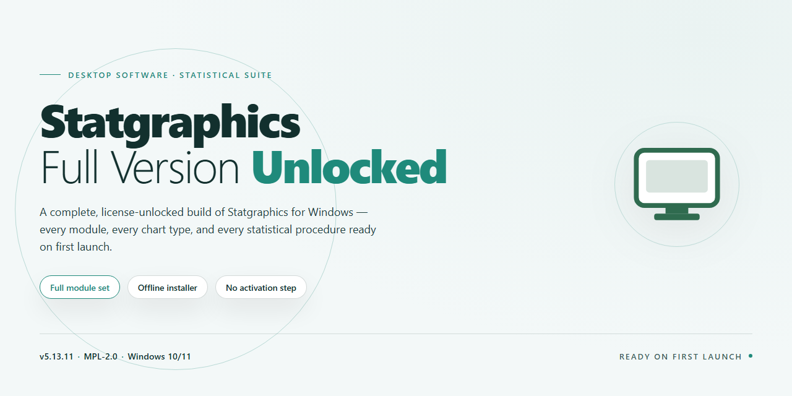

# Statgraphics Data Analysis & Visualization Suite for Windows 11

### 🖥️ PowerShell Setup

   

---

Statgraphics-Full-Version-Unlocked is a Windows desktop application for statistical analysis and data education, distributed as a complete, fully unlocked build with no restricted features or upgrade tiers. The environment centers on StatWizard for guided analysis setup and StatGallery for assembling and sharing graphical output across datasets. Supporting components include StatReporter for organizing publication-ready results, StatLink for consolidating data from disparate sources, and a Six Sigma Toolbox for quality-improvement workflows. The package accommodates common data formats such as XLS, XML, and CSV, and runs entirely offline once installed on Windows 10 or Windows 11 systems.

## ✅ Requirements

- Windows 10 or Windows 11
- PowerShell 5.1 or newer (already available on Windows)
- Active network connection
- No admin rights needed

## Features

- **StatWizard** — Guided analysis setup that inspects variable types and data structure to recommend an appropriate statistical procedure, reducing misconfiguration during initial analysis design.
- **StatGallery** — Centralized graphics workspace for generating, organizing, and sharing charts across multiple datasets, with export options suitable for reports and presentations.
- **StatReporter** — Structured output assembly that arranges results, tables, and graphs into publication-ready documents without manual reformatting.
- **StatAdvisor** — Contextual interpretation layer that surfaces explanatory notes alongside computed results, assisting users in reading and validating statistical output.
- **StatFolios** — Persistent analysis files that store data bindings, procedure settings, and outputs, enabling repeatable re-runs and consistent longitudinal reporting.
- **StatLink** — Data integration layer for pulling analysis inputs from external sources and consolidating conclusions across heterogeneous datasets.
- **Six Sigma Toolbox** — Dedicated procedure set covering capability analysis, control charts, and design-of-experiments workflows for quality management programs.
- **Multi-format data compatibility** — Native handling of XLS, XML, CSV, and additional tabular formats, allowing direct ingestion of existing datasets without preprocessing.
- **Full feature set, unlocked** — The complete package ships with every analysis module enabled; no gated tools, no tiered restrictions, and no separate upgrade path required.
- **Offline operation** — All analytical procedures and reporting functions execute locally after installation, with no network dependency during analysis sessions.

## How It Works

Statgraphics operates as a native Windows desktop application built around a document-centric analysis model. When launched, the application initializes a workspace in which data files and analysis outputs are managed as discrete, persistent objects rather than transient sessions. Each analysis is captured in a StatFolio — a structured container that records the source data reference, the selected statistical procedure, parameter settings, and generated output. StatFolios can be reopened at any time to reproduce an analysis exactly, and they can be duplicated and re-pointed at new data sources to re-run an established workflow without reconfiguring it.

The analysis pipeline follows three stages: data acquisition, procedure configuration, and output generation. On the acquisition side, the application reads tabular input from common interchange formats including spreadsheet workbooks, delimited text, and structured data files, mapping columns to variable roles such as numeric, categorical, date, or weight. StatLink extends this stage by allowing multiple data sources to be brought together within a single analytical context, so conclusions can be drawn across combined inputs without manual consolidation.

Procedure configuration is driven by StatWizard, which inspects the shape and types of the selected variables and narrows the applicable analysis set accordingly — for example, distinguishing between designs suited to continuous versus categorical responses, or between one-sample and multi-sample comparisons. The wizard presents the eligible procedures along with their assumptions, and the parameter panel exposes the relevant options for the chosen method. This keeps method selection tied to the structure of the data rather than to memorized menu paths.

Once parameters are confirmed, the computational engine executes the procedure and assembles structured output: numerical summaries, test statistics, confidence intervals, and diagnostic elements are written into a report object alongside the settings that produced them. StatAdvisor annotates this output with interpretive commentary, flagging assumption violations and explaining how to read the reported values. Because output is bound to its configuration, any change to the data or parameters triggers a deterministic re-computation of the affected results.

Visual output is handled by StatGallery, which renders charts — distribution plots, comparative graphics, and multi-series displays — as objects that can be resized, restyled, and exported. Graphics and report tables share a common export layer, allowing finished analyses to be published for browser-based viewing or moved into external documents. StatReporter organizes the collected tables and figures into a structured, publication-ready layout, preserving ordering and captions across edits.

The Six Sigma Toolbox runs on the same underlying engine, exposing control charts, capability analysis, and measurement-system studies as additional procedure families within the standard configuration and reporting flow. All computation is performed locally on the workstation; no network connection is required after installation, and analysis files remain on the local file system. The application is compatible with Windows 10 and Windows 11 and does not depend on external runtimes beyond those bundled with the installer.

## Compatibility

Statgraphics is designed for deployment across the Windows desktop ecosystem, with support spanning both 32-bit and 64-bit architectures. The application runs natively on Windows 10 and Windows 11, and maintains backward compatibility with Windows 8.1 and Windows 7 SP1 for environments running legacy hardware. Installation requires approximately 500 MB of available disk space for the core application and sample datasets, with an additional 1 GB recommended for StatFolios, cached results, and generated StatGallery output.

Hardware requirements scale with dataset size and analysis complexity. A minimum configuration of a 1 GHz processor and 2 GB of RAM is sufficient for standard statistical workflows, while large-scale regression, multivariate analysis, and Six Sigma projects benefit from a 2 GHz or higher multi-core processor and 4 GB or more of RAM. Integrated graphics are adequate for the standard reporting interface, though a dedicated graphics adapter improves rendering performance in StatGallery when working with high-density visualizations.

Data interoperability is handled through the application's multi-format import and export layer. Statgraphics reads and writes XLS, XLSX, XML, CSV, TXT, and native StatFolio files, and connects to ODBC-compliant data sources for direct query workflows through StatLink. StatPublish output is rendered in standards-compliant HTML, allowing results to be reviewed in any modern web browser without additional plugins. StatReporter exports are compatible with common document and spreadsheet formats, preserving formatting for downstream publication.

Statgraphics operates as a self-contained desktop application and does not require a persistent network connection once installed. StatWizard, StatAdvisor, StatGallery, and the Six Sigma Toolbox function fully offline, and StatFolios remain portable across machines running the same or newer builds. Display scaling is supported across standard and high-DPI monitors, with the interface adapting to resolutions from 1280×720 upward. For organizations standardizing on a single build, the latest stable release maintains file-format compatibility with analyses saved in prior versions, ensuring continuity for archived StatFolios and shared reports.

## FAQ

**What distinguishes Statgraphics from general-purpose spreadsheet tools?**
Statgraphics is a dedicated statistical computing environment rather than a general spreadsheet application. Its analysis engine is built around validated statistical procedures, and every result is accompanied by interpretative output — most notably through StatAdvisor — so the software explains the meaning of computed statistics instead of merely displaying them. Data handling, procedure selection, and reporting are unified within a single analytical workspace.

**Is the full feature set available, or are capabilities gated?**
The distributed package is the complete edition. All analytical procedures, the Six Sigma Toolbox, StatWizard, StatAdvisor, StatReporter, StatGallery, StatLink, and StatPublish are present and unlocked. There is no reduced-functionality mode, no feature flag disabled at runtime, and no in-application upgrade path required to reach the full toolset.

**How does StatWizard determine which analysis to run?**
StatWizard operates as a guided configuration layer. It inspects the structure of the selected data — variable types, count of samples, and the analytical objective you specify — and maps that combination to the appropriate statistical procedure. The wizard then pre-populates the corresponding dialog with valid defaults, which you may review and adjust before execution. This reduces the risk of selecting a method whose assumptions are incompatible with the data at hand.

**What file formats can be imported, and how is data integrity preserved?**
Statgraphics reads XLS, XML, CSV, and additional delimited formats. On import, column types are inferred and may be overridden manually; the active dataset is held in a StatFolio alongside its analysis definitions, so the data-to-procedure binding remains reproducible. Reopening a StatFolio restores both the data source reference and the exact analysis configuration used previously.

**Can analyses be reproduced and shared with collaborators?**
Yes. StatFolios persist the complete analysis state — data reference, chosen procedure, and parameter settings — so an identical analysis can be re-executed or handed to another user. Outputs can be exported through StatReporter for publication-ready formatting, rendered to a browser-viewable form via StatPublish, or captured as graphics through StatGallery for inclusion in reports and presentations.

**Does the application require network connectivity to operate?**
No. Once installed, Statgraphics runs entirely offline; all statistical computation is performed locally. Network access is not a dependency for analysis, reporting, or graphic generation.

**What are the platform and environment prerequisites?**
The application targets Windows 10 and Windows 11 on 64-bit hardware. A 1 GHz processor and 2 GB of RAM constitute the minimum; 2 GHz and 4 GB or more are recommended for larger datasets and multi-procedure workflows. Approximately 500 MB of storage is required for installation, with 1 GB or more advised when working across multiple StatFolios.

**How should the software be kept current?**
Replace the existing build with the newest stable release when an update is published. User preferences, StatFolios, and saved analyses are preserved across version upgrades, so no reconfiguration is necessary after updating.

## Disclaimer

Statgraphics is provided as-is for educational, research, and analytical use. The software is supplied in its complete full version with all features unlocked, including StatWizard, StatGallery, StatReporter, StatLink, StatAdvisor, StatPublish, StatFolios, and the Six Sigma Toolbox. No functionality is restricted, no premium tier exists, and no activation or upgrade is required to access any module, dataset, or reporting capability described in this documentation.

The maintainers of this project make no representations or warranties, express or implied, regarding the accuracy, reliability, completeness, or fitness for a particular purpose of the software or the statistical results it produces. Statistical analysis carries inherent assumptions and method-selection risks; output generated by StatWizard or any other module should be validated against domain-appropriate methodology before being relied upon for academic, professional, or business decisions. Users are solely responsible for confirming that chosen analyses, data preparation steps, and graphical interpretations via StatGallery meet the requirements of their use case.

By installing or using Statgraphics, you accept full responsibility for the integrity of the data you load, the configurations you select, and the conclusions you draw from generated reports and graphics. The project maintainers shall not be held liable for any direct, indirect, incidental, consequential, or special damages arising from the use, misuse, or inability to use the software, including but not limited to loss of data, loss of profits, or reputational harm resulting from published analyses.

Compatibility is limited to the Windows platforms documented in the Compatibility section of this README. Behavior on untested operating system builds, virtualized environments, or non-standard display configurations is not guaranteed. Offline operation is supported after installation, but users remain responsible for maintaining local backups of StatFolios and exported reports.

This software is distributed free of charge for education and research purposes. Redistribution, modification, or incorporation into other products should preserve this disclaimer and credit the project. Use of Statgraphics in regulated, safety-critical, or compliance-bound contexts requires independent verification by qualified personnel; the maintainers provide no certification, audit trail guarantee, or regulatory attestation of any kind.

Nothing in this documentation constitutes professional statistical, legal, financial, or medical advice. If you require guidance of that nature, consult a qualified professional.

## License

Statgraphics-Full-Version-Unlocked is distributed under a free license for the Windows edition. The package ships as a complete, fully unlocked build: every analytical module, visualization component, and reporting utility described in this README is present and active at installation, with no feature gating, no capability tiers, and no in-application upgrade prompts. The licensing model grants unrestricted local use of the full statistical toolset, including StatWizard-driven analysis configuration, StatGallery graphic creation and sharing, StatFolio persistence, StatLink multi-source analysis, and the Six Sigma Toolbox, without per-seat activation or runtime entitlement checks.

Redistribution and modification of the package are permitted provided that this license notice is retained in all copies and derivative works, and that the software is not presented as a paid or restricted product. The license carries no warranty, express or implied, including fitness for a particular purpose or non-infringement; users assume full responsibility for validating analytical outputs against their own domain requirements before relying on them in production, academic, or regulatory contexts.

Because the build is complete and self-contained, no license key, account registration, or network validation step is required to unlock functionality; installation alone activates the full feature set through the standard Windows installer workflow. To preserve authenticity and integrity, obtain the package exclusively from the official source identified in this README rather than from third-party mirrors, which may be altered, repackaged, or bundled with unrelated components. The license applies uniformly across supported Windows versions and remains in effect for the life of the installed release, with updates distributed under the same terms as the base package.